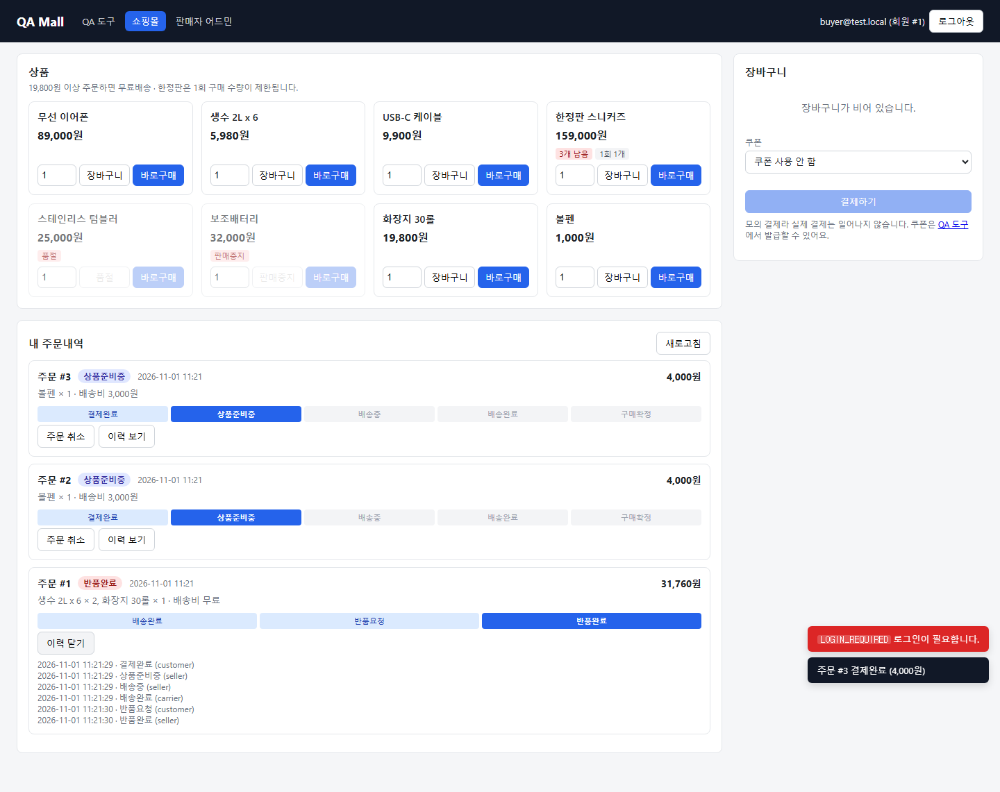
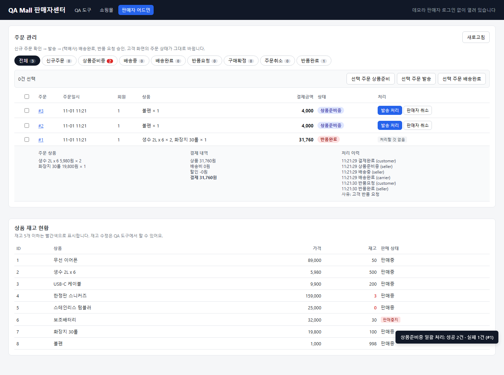
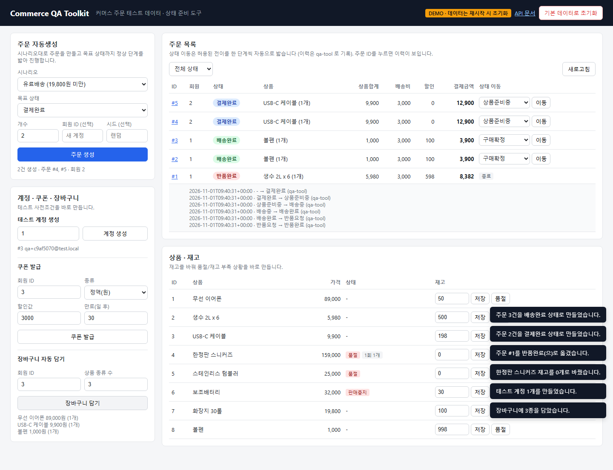

# Commerce QA Toolkit

[](https://github.com/yoplekiller/CommerceQAToolkit/actions/workflows/tests.yml)

오픈마켓형 커머스 주문 서비스(테스트 대상 API)와, 테스트 사전조건을 명령 한 줄로 만들어주는 **QA 도구**
(주문 자동생성 / 상태 자동완료 / 장바구니 자동 담기 / 재고 조정 / 계정·쿠폰 발급 / 초기화).

> "배송완료된 쿠폰 주문으로 반품 테스트"를 하려면 원래는 장바구니 담기 → 결제 → 판매자 발송 → 배송완료까지 손으로 넘겨야 한다.
> 이 도구로는 `python qatool.py orders gen --scenario coupon_fixed --status DELIVERED` 한 줄이면 된다.

**🔗 라이브 데모: https://commerce-qa-toolkit.onrender.com** (무료 플랜이라 첫 접속은 30초 정도 걸릴 수 있음)

상세 명세(상태 흐름, 도메인 규칙 R1~R15, API 목록, 시드 데이터): [docs/SPEC.md](docs/SPEC.md)

## 화면 3개

실제 회사처럼 **고객 · 판매자 · QA** 가 각자 쓰는 화면을 나눴다. 셋 다 같은 서버/DB 를 보므로, 한 화면에서 바꾼 주문 상태가 다른 화면에 그대로 반영된다.

| 화면 | 주소 | 누가 | 하는 일 |
|---|---|---|---|
| **쇼핑몰** | [`/shop`](https://commerce-qa-toolkit.onrender.com/shop) | 고객 | 이메일 간이 로그인 → 상품 담기/바로구매 → 쿠폰 선택 → 결제 → 내 주문내역(진행 단계, 취소 · 반품 신청 · 구매확정) |
| **판매자 어드민** | [`/admin`](https://commerce-qa-toolkit.onrender.com/admin) | 판매자 · 택배사 | 상태 탭(건수) → 주문 확인 · 발송 · 배송완료 · 반품 승인 · 판매자 취소, 일괄 처리, 재고 현황 |
| **QA 도구** | [`/`](https://commerce-qa-toolkit.onrender.com/) | 테스터 | 위 두 화면을 테스트할 데이터를 미리 만듦: 주문 자동생성 · 상태 자동완료 · 재고/품절 · 계정 · 쿠폰 · 장바구니 |

예) 어드민 "반품 승인" 화면을 테스트하려면 원래 쇼핑몰에서 주문 → 어드민에서 발송 → 배송완료 → 쇼핑몰에서 반품 신청까지 해야 한다. QA 도구에서 `반품요청` 상태 주문을 바로 만들면 그 준비가 버튼 한 번이다.

| 쇼핑몰 | 판매자 어드민 |
|---|---|
|  |  |



- 쇼핑몰의 배송비 · 할인 · 결제금액은 화면에서 계산하지 않고 서버 **주문서 계산 API(`/orders/quote`)** 결과를 그대로 보여준다 → 화면 금액 = 실제 결제 금액
- 어드민 처리 버튼과 QA 도구 상태 이동 메뉴는 서버 상태 전이표 범위만 노출, 일괄 처리는 건별 결과(성공/실패)를 모아 알려준다
- 모든 조작 요소에 `data-testid`
- 데모라 로그인은 이메일만(비밀번호 없음), 판매자 어드민은 인증 없이 열려 있다

### 공개 데모 배포 (Render)

데모: https://commerce-qa-toolkit.onrender.com · API 문서: https://commerce-qa-toolkit.onrender.com/docs

`render.yaml`(Render Blueprint) 설정으로 배포되고, main 에 push 하면 자동 재배포된다. 데모는 `DEMO_MODE=true` 라서 화면이 QA 토큰을 자동으로 채운다(가짜 데이터라 공개해도 되는 경우에만 켤 것).
무료 플랜은 15분간 요청이 없으면 잠들고 깨어날 때 데이터가 초기화된다(`AUTO_SEED=true` 로 기본 상품 자동 생성). 첫 접속은 30초 정도 걸릴 수 있다.

## 실행

```bash
pip install -r requirements.txt
uvicorn app.main:create_app --factory --reload   # 웹 화면 http://127.0.0.1:8000 · API 문서 /docs
```

## QA 도구 CLI

```bash
python qatool.py seed                                   # 초기화 + 기본 상품 8종
python qatool.py users --count 5                        # 테스트 계정 5개
python qatool.py coupon --user 1 --type FIXED --value 3000 --expires-days -1   # 만료 쿠폰
python qatool.py stock 4 0                              # 4번 상품 품절 만들기
python qatool.py cart --user 1 --count 3                # 장바구니 자동 담기
python qatool.py orders gen --count 3 --scenario coupon_percent --status DELIVERED --seed 1
python qatool.py orders advance 1 --to RETURNED         # 주문 상태 자동완료
python qatool.py orders show 1                          # 상세 + 상태 이력
```

```
  ID              상태  상품합계  배송비    할인  결제금액  상품
   1         DELIVERED     5,980   3,000     598     8,382  생수 2L x 6(1개)
   2         DELIVERED    19,800       0   1,980    17,820  화장지 30롤(1개)
   3         DELIVERED    89,000       0   5,000    84,000  무선 이어폰(1개)

$ python qatool.py orders advance 1 --to RETURNED
이력: PAID -> PREPARING -> SHIPPING -> DELIVERED -> RETURN_REQUESTED -> RETURNED
```

| 환경변수 | 기본값 | 설명 |
|---|---|---|
| `DB_PATH` | `commerce.db` | SQLite 파일 |
| `QA_TOKEN` | `local-qa-token` | QA 도구 API `X-QA-Token` 헤더 값 |
| `QA_TOOLS_ENABLED` | `true` | `false`면 `/qa/*` 전체 404 (운영 노출 방지) |
| `QA_BASE_URL` | `http://127.0.0.1:8000` | CLI가 호출할 서버 |
| `DEMO_MODE` | `false` | `true`면 웹 화면에 QA 토큰 자동 입력 (공개 데모용) |
| `AUTO_SEED` | `false` | `true`면 시작 시 상품이 없을 때 시드 데이터 생성 |

## 설계 포인트

- **자동완료는 DB 덮어쓰기가 아니라 허용된 전이를 한 단계씩 밟는다** (목표 상태까지 최단 경로를 BFS로 계산) → 상태 이력이 실제 흐름과 동일하게 남고, 취소/반품 시 재고·쿠폰 복구도 실제와 똑같이 일어난다.
- **주문 자동생성/장바구니 담기도 서비스와 같은 로직을 거친다** → 품절·판매중지·구매제한 초과 같은 "실제로는 생길 수 없는 데이터"가 만들어지지 않는다.
- 재고 차감은 `UPDATE ... WHERE stock >= ?` 조건부 갱신으로 초과 판매를 막는다.
- `--seed`로 같은 주문 데이터를 재현할 수 있다.
- QA 도구 API는 토큰 + 기능 플래그로 보호.

## 테스트

```bash
pip install -r requirements-dev.txt
python -m playwright install chromium

pytest                 # 전체 149건 (끝에 SPEC 규칙 R1~R15 별 테스트 수 출력)
pytest -m "not e2e"    # 브라우저 없이 API + QA 도구만
pytest -m e2e          # 웹 화면 E2E 만
pytest --rule R7       # 특정 규칙(docs/SPEC.md) 테스트만
```

| 위치 | 내용 | 수 |
|---|---|---|
| `tests/api/` | 서비스 API: 도메인 규칙 R1~R15, 경계값(무료배송 19,799/19,800, 수량 0/1/99/100, 구매제한, 쿠폰 최소주문·최대할인), 상태 전이 전체, 주문서 계산·로그인·주문내역·어드민 목록 | 109 |
| `tests/e2e/` | 웹 화면 (Playwright, `data-testid` 로케이터). QA 도구: 주문 생성, 상태 이동·이력, 이동 가능 상태만 노출, 품절, 에러 토스트, 초기화 2단계 / 쇼핑몰·어드민: 비로그인 차단, 품절 버튼 비활성, 무료배송 경계 안내, 구매제한 에러, 쿠폰 적용, 결제 후 장바구니 비움, 배송 전만 취소, 상태 탭 건수·필터, 일괄 처리 부분 실패, **고객↔판매자 탭을 오가는 주문→발송→배송완료→반품→승인→재고 복구 전체 흐름** | 17 |
| `tests/test_qa_tools.py` | QA 도구 자체 검증 | 23 |

- 사전조건(계정·쿠폰·재고·특정 상태 주문)은 전부 **QA 도구(`/qa/*`)로 준비**하고, 테스트 본문엔 검증 대상 호출과 assert 만 둔다.
- CI 는 API / E2E 잡을 나눠 돌리고, JUnit XML 과 E2E 실패 시 Playwright trace·스크린샷을 artifact 로 올린다.
- 변경 기록: [docs/changes/](docs/changes/)

## 로드맵

- [x] v1: 서비스 API + QA 도구 API + CLI
- [x] 서비스 API 자동화 테스트 스위트 (pytest, 도메인 규칙 R1~R15) + 웹 화면 E2E
- [x] v2: QA 도구 웹 화면 + Render 배포 설정
- [x] v3: 쇼핑몰(`/shop`) + 판매자 어드민(`/admin`) 화면, 주문서 계산 API
- [ ] v4: Slack 슬래시 커맨드
