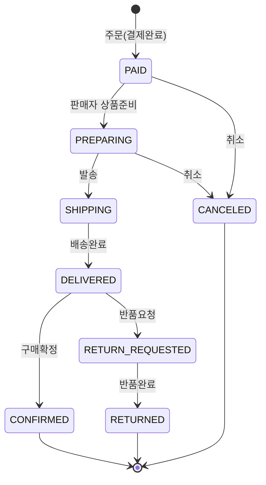

# Commerce QA Toolkit 명세

오픈마켓형 커머스 주문 서비스(테스트 대상)와, 그 서비스의 테스트 데이터/상태를 만들어주는 **QA 도구**를 한 레포에 둔다.
"배송완료된 쿠폰 주문으로 반품 테스트"를 하려면 원래는 상품 담기 → 결제 → 판매자 발송 → 배송완료까지 손으로 넘겨야 한다. 이 준비 작업을 명령 한 줄로 줄이는 것이 목적.

## 1. 구성

| 구성 | 역할 | 작성 |
|---|---|---|
| 커머스 주문 API (FastAPI + SQLite) | 테스트 대상 서비스. 상품/회원/쿠폰/장바구니/주문 | Claude |
| QA 도구 API (`/qa/*`) + CLI(`qatool.py`) | 주문 자동생성, 상태 자동완료, 장바구니 자동 담기, 재고 조정, 계정/쿠폰 발급, 초기화 | Claude |
| 쇼핑몰 화면 (`/shop`) | 고객: 간이 로그인, 상품 담기/바로구매, 쿠폰 선택, 결제, 주문내역(취소·반품·구매확정) | Claude |
| 판매자 어드민 화면 (`/admin`) | 판매자·택배사: 상태 탭, 주문 확인·발송·배송완료·반품 승인·판매자 취소, 일괄 처리, 재고 현황 | Claude |
| QA 도구 화면 (`/`) | 테스터: 위 두 화면 테스트용 데이터 준비 | Claude |
| Slack `/qa` (`POST /slack/commands`) | 테스터: QA 도구 기능(주문 생성 · 상태 이동 · 조회 · 재고 · 계정 · 쿠폰 · 초기화)을 Slack 에서 실행 | Claude |
| 자동화 테스트 (pytest API / Playwright E2E) | 위 서비스와 화면을 검증. 사전조건은 QA 도구로 준비 | Claude (변경 기록은 docs/changes/) |

## 2. 주문 상태 흐름

| 상태 | 의미 | 들어오는 주체 |
|---|---|---|
| PAID | 결제완료 (주문 생성 = 모의 결제 성공) | 고객 |
| PREPARING | 상품준비중 | 판매자 |
| SHIPPING | 배송중 | 판매자 |
| DELIVERED | 배송완료 | 택배사 |
| CONFIRMED | 구매확정 | 고객 |
| CANCELED | 주문취소 | 고객 / 판매자 |
| RETURN_REQUESTED | 반품요청 | 고객 |
| RETURNED | 반품완료 | 판매자 |

- 허용된 화살표로만 한 단계씩 이동, 역방향 불가
- **취소는 배송 시작 전(PAID/PREPARING)까지만**, 그 이후는 반품 요청
- **반품 요청은 DELIVERED 에서만** (구매확정 후 불가)
- 모든 상태 변경은 `order_status_history`에 (이전상태, 다음상태, 변경주체, 시각)으로 기록

## 3. 도메인 규칙 (= 테스트 포인트)

| # | 규칙 | 에러 코드 |
|---|---|---|
| R1 | 판매 중지 상품은 주문/장바구니 담기 불가 | `PRODUCT_INACTIVE` |
| R2 | 재고 0 이면 품절 | `SOLD_OUT` |
| R3 | 주문 수량 > 재고 이면 불가 | `INSUFFICIENT_STOCK` |
| R4 | 상품별 1회 구매 제한 초과 불가 (한정판) | `PURCHASE_LIMIT_EXCEEDED` |
| R5 | 수량은 1~99, 같은 상품이 여러 줄이면 합친 수량으로 검사 | `INVALID_QUANTITY` |
| R6 | 주문 시 재고 차감 (조건부 UPDATE 로 초과 판매 방지) | - |
| R7 | 상품 합계 ≥ 19,800원이면 배송비 0원, 미만이면 3,000원 (**쿠폰 할인 전 금액 기준**, 19,800원 정확히 = 무료) | - |
| R8 | 쿠폰: 본인 쿠폰만 / 만료 불가 / 이미 사용 불가 / 쿠폰 최소주문금액 충족 | `COUPON_NOT_OWNED` `COUPON_EXPIRED` `COUPON_ALREADY_USED` `COUPON_MIN_ORDER_NOT_MET` |
| R9 | 정액 쿠폰 할인 = 쿠폰금액(상품 합계 초과 불가), 정률 쿠폰 = 상품합계 × %(원 단위 버림), 최대할인 상한 | - |
| R10 | 결제금액 = 상품합계 + 배송비 − 할인 (배송비는 할인 대상 아님) | - |
| R11 | 취소/반품완료 시 재고와 쿠폰 복구 | - |
| R12 | 허용되지 않은 상태 전이 거부. 구매확정·반품요청은 고객 API 로만 가능 (판매자/택배사 상태변경 API 로는 거부) | `INVALID_STATUS_TRANSITION` `STATUS_NOT_ALLOWED_FOR_ACTOR` |
| R13 | 배송 시작 후 취소 거부 | `CANCEL_NOT_ALLOWED` |
| R14 | 배송완료가 아닌 주문의 반품 요청 거부 | `RETURN_NOT_ALLOWED` |
| R15 | 장바구니: 같은 상품을 다시 담으면 수량 합산, 추가 수량(1~99)과 합산 수량 모두 R1~R5 기준으로 검사. 장바구니 주문 후 장바구니 비움(주문 실패 시 유지) | `EMPTY_CART` |

에러 응답 형식: `{"error": {"code": "...", "message": "..."}}`

## 4. 서비스 API

| Method | Path | 설명 |
|---|---|---|
| GET | `/products`, `/products/{id}` | 상품 목록 / 상세 |
| POST | `/users` | 회원 가입 |
| POST | `/users/login` | 데모용 간이 로그인 (이메일만) |
| GET | `/users/{id}` | 회원 정보 |
| GET | `/users/{id}/orders` | 내 주문내역 (최신순) |
| GET | `/users/{id}/coupons` | 보유 쿠폰 |
| GET / POST | `/users/{id}/cart` | 장바구니 조회 / 담기 |
| DELETE | `/users/{id}/cart/{product_id}` | 장바구니 삭제 |
| POST | `/orders` | 바로 주문 |
| POST | `/orders/quote` | 주문서 금액 계산 (저장 안 함, items 생략 시 장바구니 기준, 무료배송까지 남은 금액 포함) |
| POST | `/orders/checkout` | 장바구니 주문 |
| GET | `/orders/{id}` | 주문 상세 (항목 + 상태 이력) |
| POST | `/orders/{id}/status` | 판매자/택배사 상태 변경 (한 단계, 구매확정·반품요청 불가) |
| POST | `/orders/{id}/cancel` | 고객 취소 |
| POST | `/orders/{id}/return` | 고객 반품 요청 |
| POST | `/orders/{id}/confirm` | 고객 구매확정 |
| GET | `/admin/orders` | 판매자 주문 목록 (status 필터) + 상태별 건수 |

## 5. QA 도구

QA 도구 API는 `X-QA-Token` 헤더가 맞아야 동작하고, `QA_TOOLS_ENABLED=false`면 404(운영 노출 방지).

| 도구 | API | CLI |
|---|---|---|
| 기본 데이터 시드 | `POST /qa/seed` | `qatool seed` |
| 전체 초기화 | `POST /qa/reset` | `qatool reset` |
| 테스트 계정 일괄 생성 | `POST /qa/users/bulk` | `qatool users --count 5` |
| 쿠폰 발급 (만료 쿠폰 포함) | `POST /qa/coupons/issue` | `qatool coupon --user 1 --type PERCENT --value 10 --expires-days -1` |
| 테스트 상품 생성 (경계값 가격) | `POST /qa/products` | - |
| 재고 조정 (품절 만들기) | `PUT /qa/products/{id}/stock` | `qatool stock 4 0` |
| 장바구니 자동 담기 | `POST /qa/carts/fill` | `qatool cart --user 1 --count 3` |
| **주문 자동생성** | `POST /qa/orders/generate` | `qatool orders gen --count 10 --scenario coupon_fixed --status DELIVERED` |
| **주문 상태 자동완료** | `POST /qa/orders/{id}/advance` | `qatool orders advance 3 --to RETURNED` |
| 주문 조회 | `GET /orders/{id}` | `qatool orders show 3` |

설계 원칙:
- **자동완료는 DB 값을 덮어쓰지 않고 허용된 전이를 한 단계씩 밟는다.** 목표 상태까지의 경로는 전이 그래프에서 최단 경로로 계산(BFS). → 상태 이력이 실제 흐름과 같게 남고(변경주체 `qa-tool`), 취소/반품 시 재고·쿠폰 복구도 실제와 똑같이 일어남
- 주문 자동생성/장바구니 담기도 서비스와 **같은 로직**을 거친다 → 품절·판매중지 상품이 담긴 주문처럼 실제로는 생길 수 없는 데이터를 막음
- `--seed` 값을 주면 같은 주문 데이터가 재현됨

주문 생성 시나리오:

| 시나리오 | 내용 |
|---|---|
| `basic` | 상품 1종 1개 |
| `multi_item` | 상품 2종 |
| `coupon_fixed` | 3,000원 정액 쿠폰 적용 |
| `coupon_percent` | 10% 정률 쿠폰 (최대 5,000원) |
| `free_shipping` | 상품 합계 19,800원 이상 (배송비 0원) |
| `paid_shipping` | 상품 합계 19,800원 미만 (배송비 3,000원) |

## 6. 시드 데이터

| ID | 상품 | 가격 | 재고 | 특징 |
|---|---|---|---|---|
| 1 | 무선 이어폰 | 89,000 | 50 | |
| 2 | 생수 2L x 6 | 5,980 | 500 | 배송비 유료 주문용 |
| 3 | USB-C 케이블 | 9,900 | 200 | |
| 4 | 한정판 스니커즈 | 159,000 | 3 | 1회 1개 구매 제한, 재고 적음 |
| 5 | 스테인리스 텀블러 | 25,000 | 0 | 품절 |
| 6 | 보조배터리 | 32,000 | 30 | 판매 중지 |
| 7 | 화장지 30롤 | 19,800 | 100 | 무료배송 기준 금액과 같은 가격 (경계값) |
| 8 | 볼펜 | 1,000 | 1000 | |

## 7. 로드맵

1. **v1 (완료)**: 서비스 API + QA 도구 API + CLI
2. **v2 (완료)**: QA 도구 웹 화면 (`/`) + Render 공개 데모 배포 설정
3. **테스트 스위트 (완료)**: pytest API 테스트(R1~R15 전부) + Playwright 웹 화면 E2E, 사전조건은 QA 도구로 준비
4. **v3 (완료)**: 쇼핑몰(`/shop`) · 판매자 어드민(`/admin`) 화면 + 주문서 계산 API
5. **v4 (완료)**: Slack 슬래시 커맨드 `/qa` — QA 도구 기능을 Slack 에서 실행 (`POST /slack/commands`, 서명 검증)
