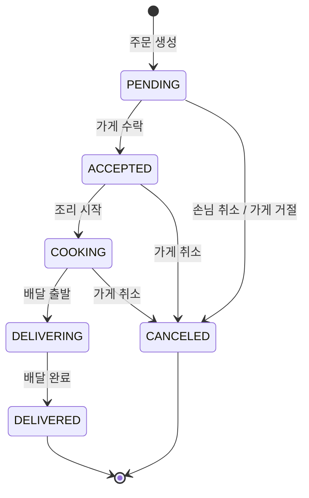

# Delivery QA Toolkit 명세

배달 주문 서비스(테스트 대상)와, 그 서비스의 테스트 데이터/상태를 만들어주는 **QA 도구**를 한 레포에 둔다.
"테스트 하나 하려고 주문 만들고 → 결제하고 → 배달완료까지 손으로 넘기는" 준비 작업을 명령 한 줄로 줄이는 것이 목적.

## 1. 구성

| 구성 | 역할 | 작성 |
|---|---|---|
| 배달 주문 API (FastAPI + SQLite) | 테스트 대상 서비스. 가게/메뉴/회원/쿠폰/주문 | Claude |
| QA 도구 API (`/qa/*`) + CLI(`qatool.py`) | 주문 자동생성, 상태 자동완료, 계정/쿠폰 발급, 초기화 | Claude |
| 자동화 테스트 (pytest API / Playwright / Postman) | 위 서비스를 검증. 사전조건은 QA 도구로 준비 | 사용자 직접 |

## 2. 주문 상태 흐름

- 한 단계씩만 이동 가능(PENDING → COOKING 건너뛰기 불가), 역방향 불가
- **손님 취소는 PENDING에서만** 가능. 그 이후는 가게 측 상태 변경으로만 취소
- DELIVERING / DELIVERED / CANCELED 에서는 취소 불가
- 모든 상태 변경은 `order_status_history`에 (이전상태, 다음상태, 변경주체, 시각)으로 기록

## 3. 도메인 규칙 (= 테스트 포인트)

| # | 규칙 | 에러 코드 |
|---|---|---|
| R1 | 영업 종료 가게는 주문 불가 | `STORE_CLOSED` |
| R2 | 품절 메뉴 주문 불가 | `MENU_SOLD_OUT` |
| R3 | 다른 가게 메뉴 섞기 불가 | `MENU_NOT_IN_STORE` |
| R4 | 수량은 1~99 | `INVALID_QUANTITY` |
| R5 | 메뉴 합계 < 가게 최소주문금액이면 주문 불가 (같으면 가능) | `BELOW_MIN_ORDER_AMOUNT` |
| R6 | 쿠폰: 본인 쿠폰만 / 만료 불가 / 이미 사용 불가 / 쿠폰 최소주문금액 충족 | `COUPON_NOT_OWNED` `COUPON_EXPIRED` `COUPON_ALREADY_USED` `COUPON_MIN_ORDER_NOT_MET` |
| R7 | 정액 쿠폰: 할인 = 쿠폰금액 (메뉴 합계 초과 불가) | - |
| R8 | 정률 쿠폰: 할인 = 메뉴합계 × % (원 단위 버림), 최대할인금액 상한 | - |
| R9 | 결제금액 = 메뉴합계 + 배달비 − 할인 (배달비는 할인 대상 아님) | - |
| R10 | 주문 취소 시 사용한 쿠폰 복구 | - |
| R11 | 허용되지 않은 상태 전이 거부 | `INVALID_STATUS_TRANSITION` |
| R12 | PENDING 이후 손님 취소 거부 | `CUSTOMER_CANCEL_NOT_ALLOWED` |

에러 응답 형식: `{"error": {"code": "...", "message": "..."}}`

## 4. 서비스 API

| Method | Path | 설명 |
|---|---|---|
| GET | `/stores` | 가게 목록 |
| GET | `/stores/{id}/menus` | 가게 메뉴 |
| POST | `/users` | 회원 가입 |
| GET | `/users/{id}/coupons` | 보유 쿠폰 |
| POST | `/orders` | 주문 생성 |
| GET | `/orders/{id}` | 주문 상세 (항목 + 상태 이력) |
| POST | `/orders/{id}/status` | 가게/라이더 상태 변경 (한 단계) |
| POST | `/orders/{id}/cancel` | 손님 취소 |

## 5. QA 도구

QA 도구 API는 `X-QA-Token` 헤더가 맞아야 동작하고, `QA_TOOLS_ENABLED=false`면 404(운영 노출 방지).

| 도구 | API | CLI |
|---|---|---|
| 기본 데이터 시드 | `POST /qa/seed` | `qatool seed` |
| 전체 초기화 | `POST /qa/reset` | `qatool reset` |
| 테스트 계정 일괄 생성 | `POST /qa/users/bulk` | `qatool users --count 5` |
| 쿠폰 발급 (만료 쿠폰 포함) | `POST /qa/coupons/issue` | `qatool coupon --user 1 --type PERCENT --value 10 --expires-days -1` |
| **주문 자동생성** | `POST /qa/orders/generate` | `qatool orders gen --count 10 --scenario coupon_fixed --status DELIVERED` |
| **주문 상태 자동완료** | `POST /qa/orders/{id}/advance` | `qatool orders advance 3 --to DELIVERED` |
| 주문 조회 | `GET /orders/{id}` | `qatool orders show 3` |

설계 원칙:
- **자동완료는 DB 값을 덮어쓰지 않고 정상 전이를 한 단계씩 밟는다.** → 상태 이력이 실제 흐름과 같게 남고, 전이 규칙도 함께 검증됨 (변경주체 `qa-tool`로 기록)
- 주문 자동생성도 서비스와 **같은 주문 생성 로직**을 거친다 → 도구로 만든 데이터가 실제로는 생길 수 없는 데이터가 되는 걸 막음
- `--seed` 값을 주면 같은 주문 데이터가 재현됨

주문 생성 시나리오: `basic`(메뉴 1종) / `multi_item`(2종 이상) / `coupon_fixed`(3,000원 쿠폰) / `coupon_percent`(10%, 최대 5,000원)

## 6. 시드 데이터

| 가게 | 최소주문 | 배달비 | 영업 | 메뉴 |
|---|---|---|---|---|
| QA치킨 | 15,000 | 3,000 | O | 후라이드 18,000 / 양념 19,000 / 콜라 2,000 / 치즈볼 5,000(품절) |
| QA분식 | 12,000 | 2,000 | O | 떡볶이 5,000 / 순대 4,000 / 김밥 3,500 / 튀김 3,000 |
| QA피자 | 20,000 | 0 | X | 페퍼로니 22,000 |
| QA카페 | 0 | 1,500 | O | 아메리카노 4,500 / 라떼 5,000 |

## 7. 로드맵

1. **v1 (현재)**: 서비스 API + QA 도구 API + CLI
2. v2: QA 도구 웹 화면 (버튼으로 주문 생성/상태 이동)
3. v3: Slack 슬래시 커맨드 (`/주문생성 coupon_fixed 3건 배달완료`)
4. 사용자 작업: pytest API 테스트 / Playwright·Postman이 QA 도구로 사전조건을 만들어 쓰는 구조
